  

 

**A curated index of top data workspaces, modern collaborative analytics platforms, interactive cloud notebooks, and open-source data engineering suites.**

[Sector Overview](#-sector-overview--market-dynamics) • [Enterprise SaaS](#-enterprise-saas-data-workspaces) • [Open-Source Solutions](#-open-source-data-workspaces) • [Star History](#-star-history) • [Support](#-support)

---

## 🌟 Overview & SEO Highlights

**Awesome Data Workspace** is a directory covering modern cloud data platforms, collaborative SQL/Python notebooks, business intelligence (BI) workbenches, and data orchestration workspaces. Whether you are engineering real-time data pipelines on modern lakehouses or conducting collaborative exploratory data analysis (EDA), this guide breaks down enterprise SaaS unit pricing economics alongside leading self-hostable open-source alternatives.

---

## 📈 Sector Overview & Market Dynamics

The global data workspace, modern analytics, and lakehouse market is estimated at **$15.2 billion in 2026** and projected to surpass **$38.4 billion by 2031** (growing at an approximate 20.4% CAGR). The market structure exhibits a **concentrated core around infrastructure and hyperscaler platforms** (where giants like Microsoft Fabric, Snowflake, and Databricks command dominant hyperscale wallet share), flanked by a **moderately fragmented, competitive application layer** of specialized collaborative notebook and BI workbenches (such as Hex, Deepnote, Preset, and Mode) competing vigorously on developer experience and AI-assisted data workflows.

---

## 🏢 Enterprise SaaS Data Workspaces

The following SaaS data platforms are sorted by enterprise scale (company valuation / market cap in descending order).

| Product | Company Valuation / Revenue | Pricing (Starting Tier) | Free Tier / Trial Limits | Description |
| :--- | :--- | :--- | :--- | :--- |
| [**Microsoft Fabric**](https://www.microsoft.com/en-us/microsoft-fabric) | **$3.1+ Trillion Market Cap** (Microsoft) | **$0.36/hour** ($262.80/month pay-as-you-go for base F2 capacity SKU with 2 Capacity Units) | **60-Day Free Trial** (includes full 64 Capacity Units, 1 TB OneLake storage, up to 100 users, no credit card required) | All-in-one unified analytics platform combining Power BI, Data Factory pipelines, Synapse Data Engineering, and OneLake lakehouse architectures. |
| [**Google Cloud BigQuery**](https://cloud.google.com/bigquery) | **$2.1+ Trillion Market Cap** (Alphabet) | **$6.25 per TiB** scanned for On-Demand query compute analysis ($0.04/GiB/mo for active logical storage) | **Free Forever Tier**: 10 GiB active data storage & 1 TiB query data analysis scanned per month (plus $300 credits for 90 days on new GCP accounts) | Serverless, highly scalable enterprise multi-cloud data warehouse and interactive workspace built for petabyte-scale SQL analytics and machine learning. |
| [**Snowflake**](https://www.snowflake.com/) | **$55+ Billion Market Cap** (NYSE: SNOW) | **$2.00 per Snowflake Credit** on Standard Edition ($3.00/credit Enterprise, $4.00/credit Business Critical) | **30-Day Free Trial** with **$400 in free usage credits** (full feature access to Standard/Enterprise compute warehouses, stage storage, and Snowpark) | Cloud-native multi-cluster shared data lakehouse and warehouse offering near-instant elastic compute scaling, Snowpark Python runtime, and data sharing. |
| [**Databricks**](https://www.databricks.com/) | **$43+ Billion Valuation** ($2.4B+ ARR) | **$0.07 per DBU** (Databricks Unit) on Standard tier ($0.15/DBU on Enterprise; Serverless SQL starts at ~$0.22/DBU) | **14-Day Free Trial** on AWS/Azure/GCP with full workspace features, Apache Spark clusters, and Databricks SQL access (cloud infra provider charges apply) | Unified Data & AI workspace built on Apache Spark, Delta Lake, and MLflow, enabling collaborative data engineering, streaming, and generative AI models. |
| [**Hex**](https://hex.tech/) | **$500+ Million Valuation** | **$36 per Editor/month** (Team tier, billed annually) | **Free Forever Tier**: Up to 5 projects, 3 active compute hours/month, community support, and standard Python/SQL workspace access | Modern collaborative workspace for data teams combining interactive SQL and Python notebooks, reactive charts, and one-click interactive data apps. |
| [**Deepnote**](https://deepnote.com/) | **$120+ Million Valuation** | **$49 per Editor/month** (Team tier, billed annually) | **Free Forever Tier**: Up to 3 editors, unlimited notebooks, 5 simultaneous notebook runs, and standard hardware execution (1 vCPU, 5 GB RAM) | Collaborative data science notebook workspace running in the cloud with real-time multi-user editing, AI autocomplete, and native database connectors. |

---

## 💻 Open-Source Data Workspaces

The following open-source workspaces, exploratory engines, and analytical platforms are sorted by repository Stars_Count (descending).

| Project | GitHub_Stars | Focus & Capabilities |
| :--- | :--- | :--- |
| [**Apache Superset**](https://github.com/apache/superset) |  | Modern enterprise-ready business intelligence web application and data exploration workspace supporting SQL lab, customizable charts, and deep dashboard creation. |
| [**Apache Airflow**](https://github.com/apache/airflow) |  | Battle-tested programmatic workflow and data workspace orchestration platform for authoring, scheduling, and monitoring complex data workflows using Python DAGs. |
| [**Streamlit**](https://github.com/streamlit/streamlit) |  | Python framework and reactive workspace for turning data scripts into shareable, interactive web applications in minutes with zero frontend code required. |
| [**DuckDB**](https://github.com/duckdb/duckdb) |  | Fast in-process analytical SQL database engine optimized for local data analytics, interactive queries, embedded execution, and seamless Parquet/Arrow interop. |
| [**Prefect**](https://github.com/prefecthq/prefect) |  | Next-generation Python workflow coordinator and data workspace orchestrator providing dynamic task execution, clear lineage, and resilient data pipeline control. |
| [**Marimo**](https://github.com/marimo-team/marimo) |  | Next-generation reactive Python notebook for data science and machine learning that executes as reproducible pure Python scripts, interactive apps, and markdown. |
| [**Cube**](https://github.com/cube-js/cube) |  | Universal semantic layer and data workspace middleware providing centralized data modeling, caching, access control, and consistent metric definitions across all consumers. |
| [**JupyterLab**](https://github.com/jupyterlab/jupyterlab) |  | Extensible next-generation web-based interactive development environment (IDE) and workspace for Jupyter notebooks, code, terminals, and interactive datasets. |
| [**dbt Core**](https://github.com/dbt-labs/dbt-core) |  | The industry standard data transformation workspace enabling data engineers and analytics engineers to build, test, and document modular SQL & Python data pipelines. |
| [**Jupyter Notebook**](https://github.com/jupyter/notebook) |  | The canonical web application for creating and sharing computational documents containing live code, mathematical equations, visualizations, and explanatory markdown text. |
| [**Evidence**](https://github.com/evidence-dev/evidence) |  | Code-driven business intelligence workspace for data analysts to build fast, beautiful, interactive data reports using markdown, SQL queries, and reactive components. |
| [**Lightdash**](https://github.com/lightdash/lightdash) |  | Open-source alternative to Looker built directly on top of dbt, empowering entire business teams to self-serve metrics and explore data workspaces reliably. |
| [**Briefer**](https://github.com/briefercloud/briefer) |  | Open-source data workspace that lets teams mix SQL and Python notebooks, share interactive widgets and dashboards, and collaborate on data analysis effortlessly. |
| [**Rill**](https://github.com/rilldata/rill) |  | Fast, bi-engine operational BI workspace combining DuckDB and Apache Druid/ClickHouse with a code-first modeling workflow for ultra-low-latency exploration dashboards. |
| [**Magda**](https://github.com/magda-io/magda) |  | Federated open-source data catalog and enterprise workspace registry for managing data discovery, metadata curation, governance, and provenance across organizations. |

---

## 📊 Star History

---

## 💖 Support & Contributing

Thank you for exploring **Awesome Data Workspace**! 🚀

If you find this repository helpful, please consider:
- ⭐ **Starring** the repository to support discovery
- 🍴 **Forking** the repo and submitting a pull request with new data tools
- 📢 **Sharing** this curated guide with fellow data engineers and analysts
- ☕ Buying a coffee or sponsoring continued development via the **[GitHub Sponsor Dashboard](https://github.com/sponsors/ishandutta2007)**

---

  Built with ❤️ by <a href="https://github.com/ishandutta2007">Ishan Dutta</a> and the open-source community. Distributed under the MIT License.

